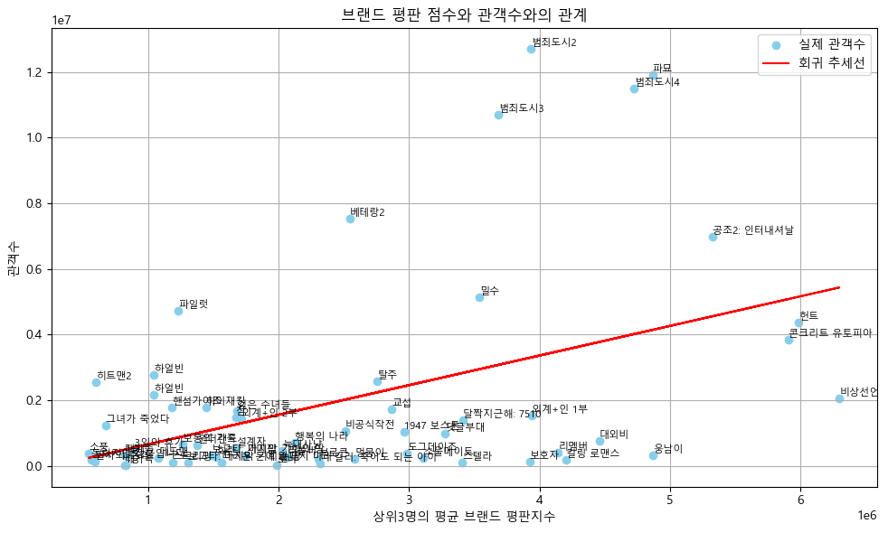
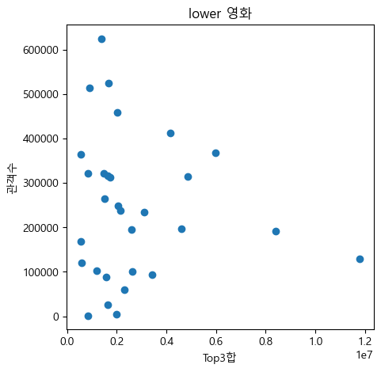
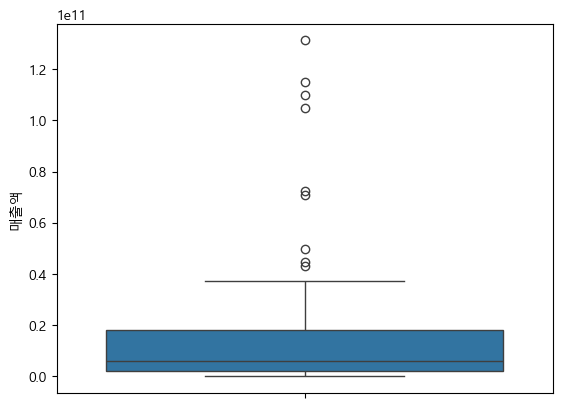
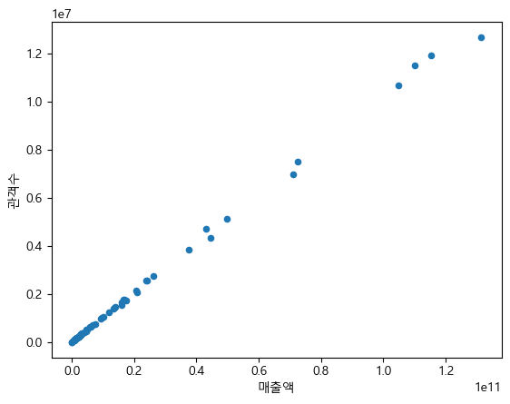
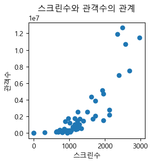

# 영화배우 브랜드평판과 관객수 분석

### 2022–2025년 영화 흥행자료를 활용한 탐색적 데이터 분석

**D&A 2025 EDA Competition · 헬로 '월' 드조**

영화 개봉 전 배우의 브랜드평판지수가 높을수록 관객수가 많은지 살펴봤습니다. 연도별 영화 흥행자료를 통합하고, 배우 이름과 **개봉 전월**을 기준으로 브랜드평판지수를 연결했습니다. 점수를 연결할 수 있는 영화 **60행**에서 관객수와의 피어슨 상관계수는 **0.448**, 단순 선형회귀의 결정계수는 **0.201**이었습니다.



## 1. 분석 질문과 지표

개봉 전에 확보할 수 있는 배우 지표와 이후의 관객수 사이에 어떤 관계가 있을까요? 이 프로젝트에서는 배우 인지도의 대리 지표로 **월별 브랜드평판지수**를, 흥행 지표로 **영화별 관객수**를 사용했습니다. 매출액과 스크린수는 분포와 관계를 비교하는 탐색 지표로 살펴봤습니다.

| 입력 | 분석에 사용한 항목 | 범위 |
| --- | --- | --- |
| 연도별 영화 흥행자료 | 영화 제목, 개봉일, 관객수, 매출액, 스크린수, 출연 배우 | 2022~2025년 파일을 통합한 149행 |
| 월별 영화배우 브랜드평판 자료 | 배우 이름, 집계 연월, 브랜드평판지수 | 개봉 전월 점수 조회에 사용 |
| 최종 분석 표본 | 배우 점수를 1개 이상 연결한 영화 행 | **60행** |

영화 자료는 영화진흥위원회 KOBIS, 배우 지표는 한국기업평판연구소를 출처로 기록했습니다. 표본 수는 제출 노트북에서 확인한 행 수입니다. [KOBIS 공식통계](https://www.kobis.or.kr/kobis/business/stat/offc/findFormerBoxOfficeList.do) · [제출 발표자료에 기록된 브랜드평판 출처](https://brikorea.com/bbs/board.php?bo_table=rep_1&wr_id=4790)

## 2. 전처리와 배우 점수 결합

1. **영화 데이터 통합** · 2022~2025년 흥행지표 엑셀을 읽어 행 단위로 합치고 개봉일을 날짜형으로 변환합니다.
2. **개봉 전월 계산** · 개봉일에서 한 달을 뺀 뒤 해당 월의 첫날을 월 키로 사용합니다. 예를 들어 2022년 5월 개봉작의 배우 점수는 2022년 4월 자료에서 조회합니다.
3. **배우 이름과 월로 결합** · 주연 열과 추가 출연자 열을 순회하며, 이름과 월이 동시에 일치하는 점수를 찾습니다. 같은 키에 여러 행이 있으면 노트북은 첫 값을 사용합니다.
4. **분석 표본 선택** · 연결되지 않은 점수를 0으로 처리한 뒤, 모든 출연 배우 점수가 0인 영화 행을 제외합니다.
5. **영화 단위 특성 생성** · 연결된 0이 아닌 점수 중 높은 순서로 최대 3개를 선택해 평균과 합계를 계산합니다. 점수가 1~2개인 영화는 확보된 점수만 사용합니다. 상관과 회귀에는 **상위 최대 3명 평균**을 사용했습니다.

## 3. 상관분석과 단순 회귀

| 항목 | 결과 |
| --- | ---: |
| 분석 행 수 | 60 |
| 피어슨 상관계수 | **0.4481** |
| 상관검정 p값 | **0.0003306** |
| 단순 OLS 결정계수 R² | **0.201** |
| 수정 결정계수 | **0.187** |

분석 표본에서는 배우 점수와 관객수 사이에 양의 선형 관계가 관측됐습니다. 단순 회귀선은 표본 내 관객수 변동의 약 **20.1%**를 설명했습니다. 산점도에서 비슷한 배우 점수의 영화들도 관객수가 넓게 분포해, 개별 영화의 흥행을 판단하려면 다른 정보가 필요합니다. 이 수치는 별도 평가 표본에서 측정한 예측 성능이 아닙니다.

### 관객수 구간별 분포



산점도 하단에 점이 몰려 있어 관객수를 **300만 이하**, **300만 초과~800만 이하**, **800만 초과**로 나눠 확인했습니다. 구간은 관객수 기준으로 지정한 고정 경계입니다. 상관검정과 회귀는 구간을 나누기 전 전체 60행에서 계산했습니다.

## 4. 흥행 지표 탐색

### 매출액 분포



매출액은 중앙값 약 **59.8억 원**, 평균 약 **191.5억 원**으로 상위 매출작이 평균을 높였습니다. 상자그림은 이 치우침을 확인하기 위해 사용했습니다.

### 매출액·스크린수와 관객수

| 매출액과 관객수 | 스크린수와 관객수 |
| --- | --- |
|  |  |

매출액과 관객수는 산점도에서 뚜렷한 양의 관계를 보였습니다. 스크린수가 많은 영화도 대체로 관객수가 많았으나, 비슷한 스크린수에서도 관객수는 넓게 분포했습니다. 두 관계는 표본에서 관측된 패턴으로 해석했습니다.

## 5. 해석 범위

- 브랜드평판지수는 배우 인지도의 대리 지표입니다. 점수가 연결된 영화 60행을 사용했으므로, 누락된 89행이나 전체 개봉작에서도 같은 관계가 성립하는지는 알 수 없습니다.
- 영화 행마다 연결된 배우 수가 다릅니다. 점수 1~2개로 계산한 영화와 3개로 계산한 영화가 함께 포함됩니다. 통합 코드에는 영화 제목 중복 제거 단계가 없습니다.
- 단순 회귀는 장르, 배급사, 개봉 시기, 마케팅, 스크린수 등을 통제하지 않았습니다. 통계적으로 관측된 연관성과 배우 인지도의 인과 효과는 구분해야 합니다.

## 6. 저장소 구성과 재현

| 경로 | 내용 |
| --- | --- |
| [movie.ipynb](movie.ipynb) | 데이터 결합, 특성 생성, 상관분석, 회귀, 시각화 |
| [assets/](assets/) | 제출 노트북의 시각화 PNG 5장 |
| [requirements.txt](requirements.txt) | JupyterLab 및 분석 라이브러리 |

1. 원본 발표 ZIP의 `EDA/data/`에서 아래 입력 파일을 꺼내 `movie.ipynb` 옆의 `data/` 폴더에 둡니다.

   ```text
   data/
     2022년도 영화별 흥행지표_ver3.xlsx
     2023년도 영화별 흥행지표_ver3.xlsx
     2024년도 영화별 흥행지표.ver6.xlsx
     2025년도 영화별 흥행지표_ver4.xlsx
     2022-2025 영화배우 브랜드 점수.xlsx
   ```

2. 저장소 최상위에서 라이브러리를 설치한 뒤 JupyterLab을 엽니다.

   ```sh
   python -m pip install -r requirements.txt
   python -m jupyter lab
   ```

3. `movie.ipynb`를 열고 위에서 아래로 실행합니다. 차트는 `Malgun Gothic`을 사용하며, 다른 환경에서는 설치된 한글 글꼴로 바꿀 수 있습니다.

공개용 패키지는 노트북과 시각화 중심으로 구성했습니다. 원본 엑셀, 별도 결과 엑셀과 발표 PDF·PPTX는 원본 ZIP에 있습니다.
